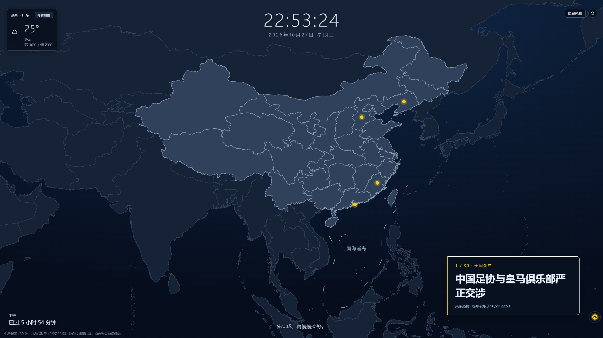
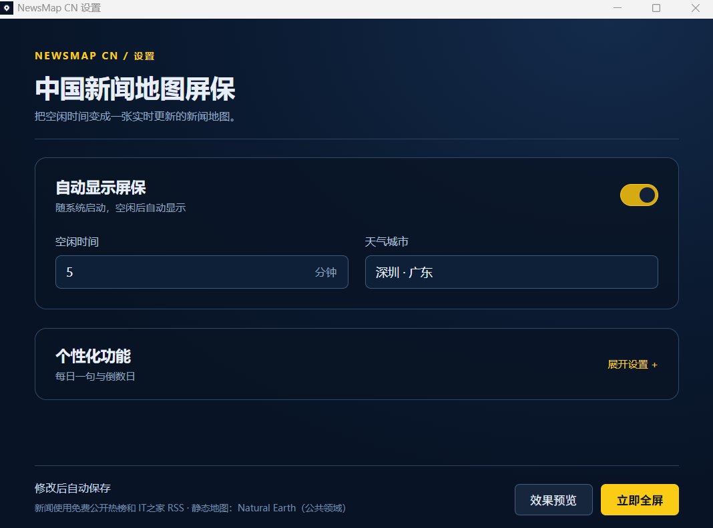

# NewsMap CN · 中国新闻地图屏保

首个公开版本 **0.1.0**，适用于 Windows 10/11 x64。普通用户下载安装版即可使用，无需配置新闻 API Key。

**[⬇ 点击下载 Windows 安装版（v0.1.0）](https://github.com/1019929331-art/NewsMap-CN/releases/download/v0.1.0/NewsMapCN_0.1.0_x64-setup.exe)**

Windows 桌面屏保：空闲超时后全屏显示以中国为中心的局部世界地图，将免费新闻按标题中的地点词估算后标在地图上，支持点击展开详情、星标收藏、F 键查看收藏并跳转网页。位置不明确的新闻归入全国热点。仅按 ESC 退出屏保。

## 界面预览

**新闻地图屏保**



**设置界面**



## 功能

- 整窗设置页：开关屏保（随系统自启）、空闲自动弹出分钟数（1–60）、搜索天气城市；展开“个性化功能”后设置每日一句和倒数日；可效果预览或立即全屏
- 深蓝渐变背景 + 局部世界地图：以中国为中心的东亚/东南亚/中亚区域真实陆地轮廓，仅中国高亮并显示省级分割线；支持以鼠标位置为中心的平滑滚轮缩放（1–4 倍）、不可拖动
- 屏保正上方显示实时时间与日期
- 可选每日一句（内置原创短句）和精确到分钟的倒计时；日期可留空，按当天计算；屏保左下角点击倒计时可编辑
- 左上角天气模块（中国天气网数据，可搜索全国地级市及地级行政区，含当前温/高低温/天气状况，15 分钟自动刷新）
- 免费头条公开热榜最多 25 条、IT之家 RSS 最多 5 条；全部新闻在右下角轮播大标题，点击打开原文，展开新闻列表时自动收起，可在右上角隐藏或显示。按标题地点词聚合打点；颜色是标题关键词倾向，不代表经过核实的情绪判断
- 多地点或无法唯一判断的标题归入「全国热点」；地点仅作位置线索
- 状态栏显示新闻上次成功获取时间；断网先显示本地缓存。IT之家 RSS 的发布时间单独标注；榜单获取时间不是新闻发布时间
- 点击展开面板中的新闻条目可跳转浏览器打开网页；右上角按钮手动刷新
- D 键切换“仅灾害新闻”筛选；断网时回退到本地缓存的上次新闻与天气
- 无法识别省份的新闻归入界面最右侧固定的「全国热点」聚合标记（不随地图缩放，展开框右对齐、不遮挡地图）
- 收藏：点击条目星号收藏/取消，按 F 查看收藏面板，点击收藏条目跳转浏览器打开新闻网页
- 托盘：左键打开设置，右键菜单可立即全屏、暂停自动显示 1 小时、本次运行暂停自动显示或恢复；重启应用后本次运行的暂停失效

## 开发运行

环境：Windows 10/11 x64、Rust stable（MSVC 或 GNU 工具链）、Node.js 24 LTS（最低 22.18）、WebView2 运行时。MSVC 需要 Visual Studio C++ Build Tools 和 Windows SDK；GNU 需要对应的 MinGW 链接器。

```bash
npm ci
npm run tauri dev
```

## 安装与打包

普通用户使用安装版无需安装 Node.js 或 Rust。NSIS 安装包按当前用户安装，不需要管理员权限，安装器提供简体中文和英文界面。便携版需完整解压后启动 NewsMapCN.exe；GNU 版本的 WebView2Loader.dll 必须和 EXE 放在同一目录。

本程序是托盘应用实现的空闲全屏展示，不是 Windows 安全锁屏，也不注册为系统 .scr 屏保。退出设置窗口后可继续在托盘运行。当前版本尚未代码签名。

```bash
npm ci
npm run release:prepare
```

脚本默认使用 Windows GNU 目标，确保安装包包含 `WebView2Loader.dll`；MSVC 环境可先设置 `NEWSMAP_TARGET=x86_64-pc-windows-msvc`。安装包、便携包、源码包和校验文件统一输出到 `.release/<版本>/`。双击 `NewsMapCN_..._x64-setup.exe` 安装；从「开始」菜单打开 NewsMap CN。开启设置里的屏保后，应用会添加当前用户开机启动项。关闭该设置或卸载应用都会移除启动项；卸载后，收藏、设置和缓存仍保存在 `%APPDATA%/com.newsmap.cn`，可手动删除。重新安装后，启动项会按保存的设置恢复。

升级时运行新版安装程序即可覆盖安装。Windows 可能对未签名安装包显示未知发布者提示。发布检查、环境准备和 GitHub 草稿流程见 [发布流程](docs/RELEASING.md)。

运行检查：

```bash
npm test
npx playwright install chromium
npm run test:ui
npm run build
cargo +stable-x86_64-pc-windows-gnu test --locked --manifest-path src-tauri/Cargo.toml
```

静态地图已内置，运行和构建不需要下载地图。需要维护地图时可按 [地图资产说明](docs/MAP_ASSETS.md)重新生成：

```bash
python scripts/prepare-map.py
```

## 数据来源

- 新闻：今日头条免费公开热榜接口（`https://www.toutiao.com/hot-event/hot-board/`，无需 API 密钥；第三方非官方接口，可能变更或限制访问，不承诺可用性）
- 科技及生活资讯：IT之家官方 RSS（`https://www.ithome.com/rss/`，无需 API 密钥；仅展示原文首段摘录并提供原文链接）
- 静态底图、省份高亮及点位：Natural Earth（公共领域，使用中国视角与小岛、海域指示线图层；可修改和再分发，来源与摘要见 `licenses/map-sources.json`）
- 天气：中国天气网（中央气象台体系，免费公开接口）

本应用没有接入收费新闻服务，不要求用户提供新闻 API 密钥。新闻与天气源暂不可用时显示本地缓存。

## 许可

自有源码采用 [MIT](LICENSE)。第三方地图、新闻、图片与天气数据不由本项目重新授权，详见 [第三方声明](THIRD_PARTY_NOTICES.md)。

当前版本使用公共领域素材生成本地静态地图。地图的来源许可、准确性核对范围以及公开地图审核事项见 [地图资产说明](docs/MAP_ASSETS.md)。此前的 0.3.x 编号为本地开发版本，首次公开发布统一使用 0.1.0。

已提供 Windows CI 和标签触发的预发布草稿工作流；首次云端运行、干净系统安装、真实游戏与视频场景仍需按发布清单确认。
